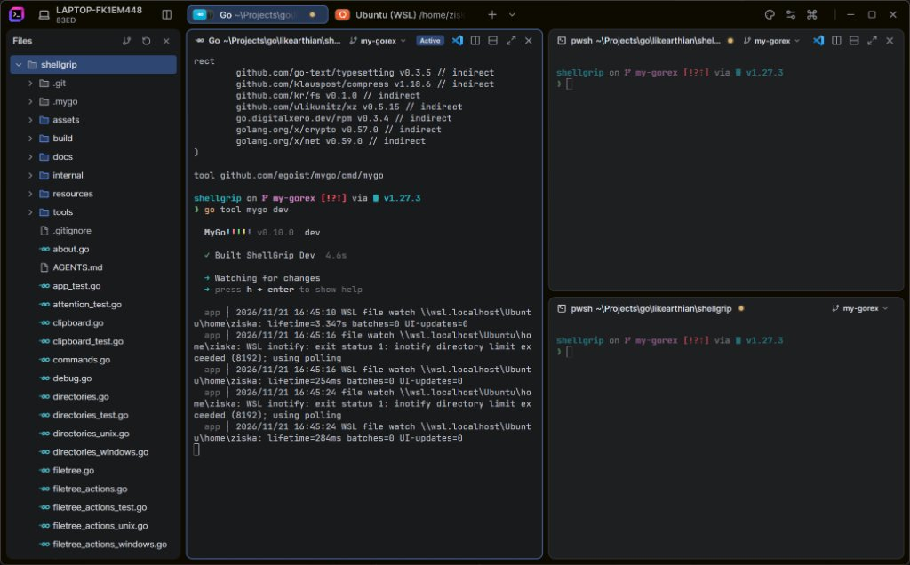

# ShellGrip

**A native terminal workspace built in Go — no webview, no cgo.**

ShellGrip is a multi-tab, split-pane terminal emulator forked from [GoRex](https://github.com/egoist/gorex) with its own feature direction. Built with [MyGo](https://mygo.egoist.dev)'s native UI and Ghostty's `libghostty-vt` terminal engine, it combines fast local and remote shells with a live file tree, built-in Source Control, side-by-side diffs, file previews, and first-class Windows/WSL and SSH support.



---

## Highlights

- **Native performance:** Pure Go + native UI + `libghostty-vt` over `purego` (no Electron, no webview, no cgo).
- **Multi-tab, split-pane workspace:** Drag-to-resize splits, pane zoom, active-pane highlighting, stacked program tab icons, and automatic layout restoration.
- **Live file tree & previews:** Follows your active shell across local folders, WSL distributions, and remote SSH/SFTP hosts, with syntax-highlighted source, Markdown, and image previews.
- **Built-in Source Control:** Stage/unstage files or folders, commit, push/pull, browse branch/tag menus, view the commit graph, and inspect side-by-side diffs without interrupting running terminal programs.
- **First-class SSH & WSL:** Save or import `~/.ssh/config` connections, browse remote files over SFTP, and run WSL shells with native Linux `inotify` relays and VS Code Remote–WSL integration.

---

## Features

### Workspace, Tabs & Panes

- **Tabs and split panes:** Each pane displays its foreground program's icon, name, and working directory in the header, along with split right, split down, zoom, and close controls. Drag dividers to resize panes (double-click to reset to 50/50).
- **Terminal profiles:** Click **+** to open your default shell, or use the dropdown to pick from installed shells and set a default. On Windows, profiles include PowerShell (`pwsh`), Windows PowerShell, Command Prompt, Git Bash, and registered WSL distributions. Splits and restored layouts preserve each pane's profile.
- **Program activity & notifications:** ShellGrip tracks each pane's foreground process (`tcgetpgrp`, `sysctl`, `proc_pidinfo`, and Windows child process inspection). A green dot indicates active output; an orange dot and amber tab flash signal a finished command, bell, or background notification, with taskbar/Dock attention until focused (respecting reduced-motion preferences).
  Quiet panes in an unfocused window are inspected every 10 seconds, including WSL wrappers; focusing the window refreshes them immediately. Recent input/output keeps checks fast, and terminal output continues normally. Background process-status changes and completion notifications may take up to 10 seconds. Filesystem watches, file preview fallback polling, and Git refreshes pause while the window is unfocused. Read-only Git queries disable optional index writes to avoid triggering their own filesystem watches.
- **Tab ergonomics:** Tabs stack the icons of their running programs (with WSL distro icons for WSL panes), support drag-to-reorder, double-click rename, and context menus.
- **Command palette:** Press `⌘⇧P` / `Ctrl+Shift+P` (or click `⌘`) for fuzzy-matched access to every command and open pane.
- **Host chip:** Displays machine name and model; its popover shows CPU, OS, user, active sessions, memory usage, app version, and an **About** dialog.
- **Single-instance & clean quit:** Launching ShellGrip while already running focuses the existing window. Closing the window quits the app and its shells, prompting first if any program or SSH session is still active. The next launch restores tabs, splits, ratios, names, and working directories.
- **VS Code integration:** Click the VS Code icon in any pane header (or right-click a folder in the file tree) to open the directory in VS Code. WSL panes and folders open via Remote–WSL (`ms-vscode-remote.remote-wsl`).

### File Tree & Live Watchers

- **Directory-following sidebar:** Toggle with `⌘⇧B` / `Ctrl+Shift+B` or the title-bar button. Follows the focused shell's working directory across local, WSL, and SSH/SFTP sessions. Drag the right edge to resize; double-click to reset. Visibility and width are persisted.
- **Context actions:** Right-click any file or folder to copy its full or relative path, open HTML files in the default browser, or open folders in VS Code.
- **Low-overhead live updates:**
  - **Local:** Native filesystem watchers with 30-second safety checks (2-second polling fallback while starting or on error). Changes automatically invalidate affected Git caches.
  - **WSL & Linux SSH:** Uses a small static Go `inotify` relay (packaged for Linux `amd64` and `arm64`, requiring neither Go nor Python on the target). Installed to the user cache and verified by SHA-256. Watches recursively without following symlinks, skips `node_modules`, and falls back to polling if the 8,192-directory limit is exceeded. SSH deployment runs in the background over SFTP while polling remains available.

### File Previews

- **Rich read-only viewer:** Click any file in the tree, or `Cmd`/`Ctrl`-click a file path printed in the terminal (including `file:line:column` links) to preview it in-place without disturbing your shell. Press `Escape` to return.
- **Supported formats:**
  - **Source code:** Syntax highlighting and line numbers (UTF-8 and Windows-1252). Files over 40 KB or with lines over 4,096 bytes use a virtualized viewer with background highlighting and bounded line wrapping.
  - **Markdown:** Headings, lists, tables, emphasis, code blocks, and local images (virtualized for documents over 40 blocks).
  - **Images:** PNG, JPEG, GIF, WebP, BMP, TIFF, and SVG (up to 32 MB / 32 MP).
- **Live reload:** Local, WSL, and remote previews reload automatically on external saves (including atomic replacement saves) while preserving scroll position.
- **Clipboard:** Select text and copy with `⌘C` / `Ctrl+C` or right-click ▸ Copy. Line numbers are excluded, and original tabs/indentation are preserved.

### Source Control & Git

- **Source Control sidebar:** Switch between **Files** and **Source Control** in the sidebar header or via the command palette. View branch status and upstream ahead/behind counts, write commit messages (`Ctrl+Enter` to commit), and stage/unstage individual files, folders, or all changes in a compact folder tree.
- **Side-by-side diff viewer:** Clicking any staged, unstaged, or untracked file opens a native read-only diff with resizable split, word-level highlighting, line numbers, search (`⌘F` / `Ctrl+Shift+F`), go-to-line (`⌃G` / `Ctrl+Shift+G`), and change navigation (`F7` / `Shift+F7`). Binary and metadata-only changes display unified patches.
- **Commit graph:** Lists recent commits with hashes, subjects, and branch/tag decorations.
- **Git branch menu:** Click the branch chip in any pane header to search and switch local/remote branches and tags, pull (**Update Project**), commit, push, create branches, or checkout revisions.
- **Non-blocking backend execution:** All Git operations run in ShellGrip's backend (and via `wsl.exe` for WSL panes), so they work even while another program owns the terminal. Credential prompts use a native hidden-password dialog via a temporary askpass helper.

### SSH & SFTP

- **Saved connections:** Manage hosts in **Settings ▸ SSH** or import `~/.ssh/config` in one click. Connections are stored in `ssh.json` inside ShellGrip's data directory; your `~/.ssh/config` is never modified.
- **Full tab experience:** SSH tabs support splitting, layout persistence, keep-alive, and native password dialogs.
- **Remote file tree & previews:** Uses SFTP over system `ssh` (respecting your keys, agent, `ProxyJump`, and config; multiplexing on macOS/Linux). An optional prompt hook for `bash`, `zsh`, and `fish` lets the file tree follow `cd` automatically (configurable per host).

### Terminal, Themes & Settings

- **Ghostty VT renderer:** Supports Kitty graphics (including Unicode image placeholders), clipboard image paste, draggable scrollback bar, smooth mouse-wheel scrolling (respecting reduced-motion), and `Ctrl`/`Cmd`+wheel font zooming across all panes.
- **Appearance & themes:** Light and dark app appearances with bundled JetBrains Mono, optional translucent window chrome (Mica Alt on supported Windows 11 builds), and a searchable library of bundled Ghostty terminal themes with live previews and ANSI swatches.
- **Settings GUI:** Configure appearance, font family and size (8–32 pt), default shell, active-pane highlighting, minimum text contrast, scroll speed, scrollback capacity (10–100 MiB per pane), and macOS Option-as-Alt.
- **Copy on select:** Enabled by default (toggle in **Settings ▸ Clipboard**). Highlight text, double-click a word, or triple-click a line to copy with a character-count toast confirmation. Hold `Shift` to select when a terminal program captures the mouse.

---

## Keyboard Shortcuts

| Action | macOS | Windows / Linux |
|---|---|---|
| New tab | `⌘T` | `Ctrl+Shift+T` |
| Split right / down | `⌘D` / `⇧⌘D` | `Ctrl+Shift+D` / `Ctrl+Shift+E` |
| Close pane / tab | `⌘W` / `⇧⌘W` | `Ctrl+Shift+W` |
| Zoom pane | `⇧⌘↩` | `Ctrl+Shift+Enter` |
| Focus adjacent pane | `⌥⌘` + Arrows | `Alt` + Arrows |
| Move nearest divider | `⌃⌘` + Arrows | `Alt+Shift` + Arrows |
| Equalize panes | `⌃⌘=` | — |
| Switch tabs | `⌘1`…`⌘9`, `⇧⌘[`, `⇧⌘]`, `⌃Tab` | `Ctrl+1`…`9`, `Ctrl+0` (tab 10), `Ctrl+PgUp/PgDn`, `Ctrl+Tab` |
| Rename tab | `⇧⌘R` | `Ctrl+Shift+R` |
| Command palette | `⇧⌘P`, `⌘P` | `Ctrl+Shift+P` |
| Clear terminal | `⌘K` | `Ctrl+Shift+K` |
| Toggle file tree | `⇧⌘B` | `Ctrl+Shift+B` |
| Text size | `⌘+`, `⌘−`, `⌘0` | `Ctrl+=`, `Ctrl+-`, `Ctrl+Shift+0` |
| Copy / Paste | `⌘C` / `⌘V` | `Ctrl+Shift+C` / `Ctrl+V` (`Ctrl+Shift+V`) |

> **Shortcut conventions (Windows & Linux):** Bare `Ctrl+<letter>` belongs to the terminal (`Ctrl+C`, `Ctrl+D`, `Ctrl+W`, etc.), so ShellGrip uses `Ctrl+Shift+<letter>`. No shortcut ever combines `Ctrl+Alt` to avoid interfering with `AltGr` typing.
>
> **Tab number hints:** Hold `Ctrl` for 0.5 seconds to reveal number badges on the first ten tabs (`Ctrl+1`–`9`, `Ctrl+0` for tab 10). `Ctrl+Shift+1`–`9` also remain available (`Ctrl+Shift+9` jumps to the last tab).

---

## Platform Notes

### macOS
- Requires macOS 13.0+.
- Data directory: `~/Library/Application Support/ShellGrip` (`ShellGrip Dev` in dev mode).

### Windows & WSL
- Requires Windows 10 1809+ (ConPTY).
- Data directory: `%AppData%\ShellGrip`.
- Uses a frameless window with custom title-bar controls and optional Windows 11 Mica Alt backdrop.
- Default shell resolution: `$SHELL` (when pointing to a Windows executable such as `nu` or Git Bash), then `pwsh`, then `powershell`, then `cmd`. PowerShell is wrapped with an OSC 7 prompt hook so pane headers and splits follow `cd`.
- **WSL:** Uses `wsl.exe --distribution <name> --cd <directory>` for pre-installed distributions. Splits inherit the active Linux directory via OSC 7 or session-tagged process lookup; Git and Source Control run inside the pane's distribution via `wsl.exe`.

### Migrating from GoRex
ShellGrip uses its own app identity (`dev.shellgrip.app`), data directory, and `SHELLGRIP_` environment variable prefix. To migrate from GoRex, close both apps and copy `settings.json`, `layout.json`, and `ssh.json` into ShellGrip's data directory. Saved credentials must be re-entered.

---

## Development & Building

### Prerequisites
- [Go](https://go.dev/dl/) **1.27.3+**
- **MyGo 0.10.0** (pinned in `go.mod` as a `tool` dependency)

### Common Commands

```sh
# Prepare Linux inotify relays for WSL/SSH development and testing
go run ./tools/mkwslwatch

# Run "ShellGrip Dev" with hot rebuild and restart (isolated data dir)
go tool mygo dev

# Run the full test suite (sessions + windowless UI tests)
go test ./...

# Build native app bundle (runs mkwslwatch automatically)
# Outputs build/<os-arch>/ShellGrip.app + .dmg (macOS) or ShellGrip.exe + Setup (Windows)
go tool mygo build

# Refresh resources/icon.png from the approved logo
go run ./tools/mkicon

# Update MyGo and its CLI together
go get -tool github.com/egoist/mygo/cmd/mygo@latest
```

> **Note:** `internal/terminal` is vendored from MyGo's terminal plugin. After updating MyGo, synchronize it following [`internal/terminal/UPSTREAM.md`](internal/terminal/UPSTREAM.md). Set `SHELLGRIP_DIR` to override the app data directory.

### Opt-in Integration Tests (Windows)

Measure WSL watcher startup, idle CPU, replacement-save latency, and 200-write burst performance against a real distribution:

```powershell
$env:SHELLGRIP_TEST_WSL_WATCH = "Ubuntu"
go test -v -run '^TestWSLFileWatchPerformance$' .
Remove-Item Env:SHELLGRIP_TEST_WSL_WATCH
```

Run an end-to-end SSH/SFTP relay loopback test (requires OpenSSH server in the target WSL distribution):

```powershell
$env:SHELLGRIP_TEST_SSH_WATCH = "Ubuntu"
go test -v -run '^TestSSHRelayLoopback$' .
Remove-Item Env:SHELLGRIP_TEST_SSH_WATCH
```

---

## Project Structure

| Path | Responsibility |
|---|---|
| `main.go` | Application entry point, window lifecycle, and askpass dispatch |
| `state.go` | Tabs, binary split tree, panes, and `layout.json` persistence |
| `view.go`, `tabs.go`, `host.go`, `commands.go` | Immediate-mode UI: title bar, tabs, panes, host popover, menus, command palette |
| `programs.go` | Foreground program names, glyphs, and tab tile colors |
| `filetree*.go`, `preview*.go` | File tree sidebar, watchers, and code/Markdown/image previews |
| `git.go`, `gitmenu.go`, `git_auth.go`, `scm*.go` | Git backend, branch menu, askpass auth, Source Control sidebar, diff viewer, commit graph |
| `ssh*.go`, `sftp*.go` | Saved SSH connections, `~/.ssh/config` import, SFTP client, and remote file tree |
| `style.go`, `themes.go`, `settings.go` | Colors, fonts, Ghostty themes, appearance, and preferences |
| `internal/session` | Cross-platform PTY management, foreground process inspection, and host info |
| `internal/terminal` | Vendored MyGo terminal plugin (`libghostty-vt` over `purego`) |
| `internal/appdir` | Platform-specific application data directory resolution |
| `tools/wslwatch`, `tools/mkwslwatch` | Static Linux `inotify` relay and cross-compiler |

---

## Credits

- **Forked from:** [GoRex](https://github.com/egoist/gorex)
- **UI & Terminal:** [MyGo](https://mygo.egoist.dev) and Ghostty's `libghostty-vt`
- **Icons:** [Lucide](https://lucide.dev) (ISC) and [Simple Icons](https://simpleicons.org) (CC0)
- **Font:** [JetBrains Mono](https://www.jetbrains.com/lp/mono/) (OFL)
